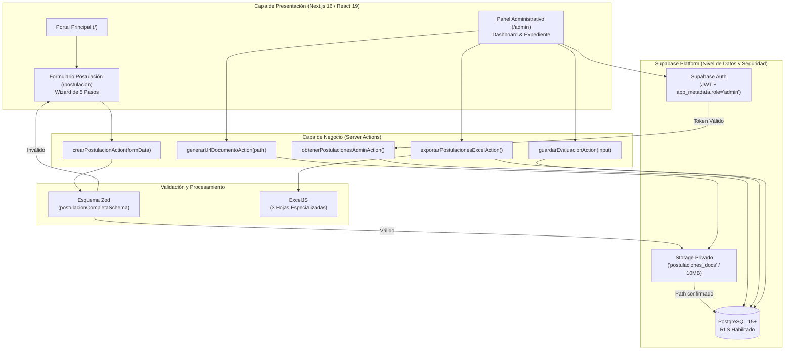
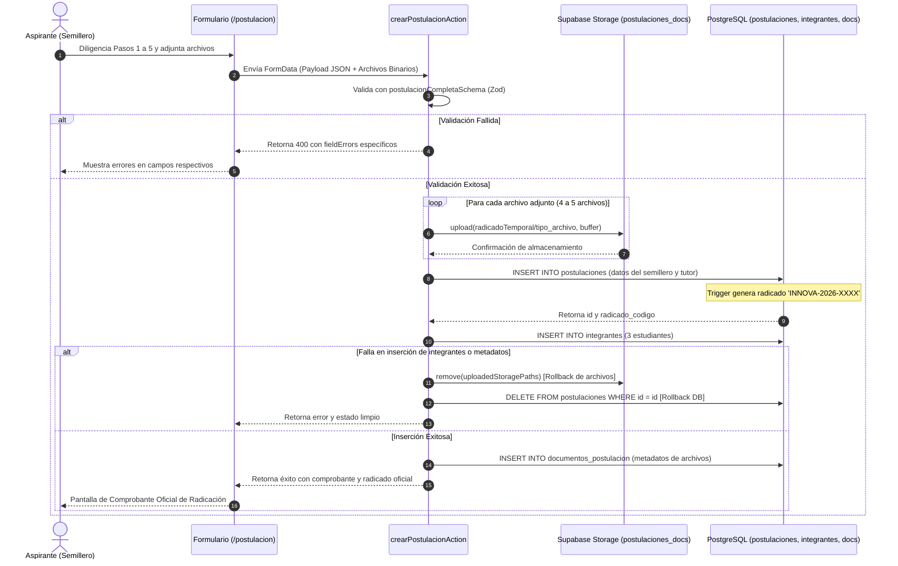
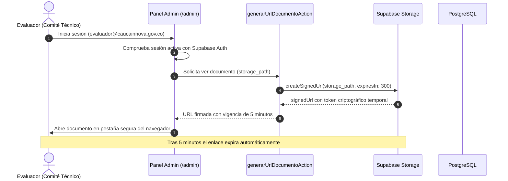
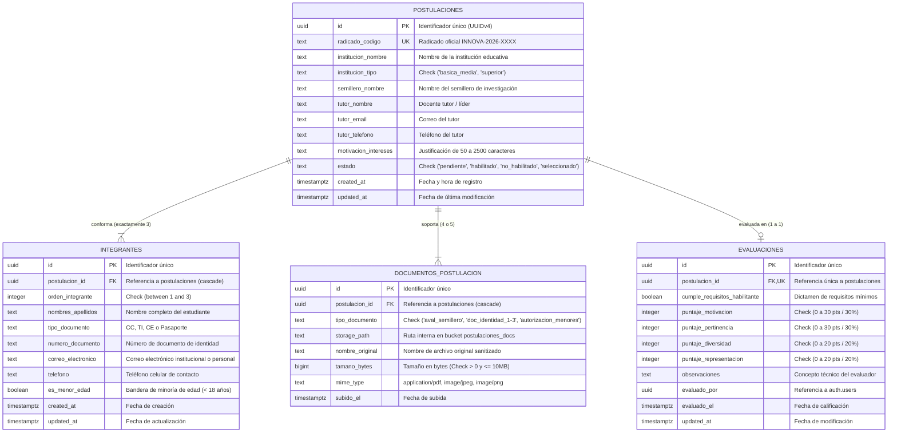

# Arquitectura Integral del Sistema
## Bootcamp de Semilleros de Investigación Cauca INNOVA 2026

**Documento:** Especificación Técnica de Arquitectura, Modelo de Datos, Seguridad y Transaccionalidad.  
**Fecha de Publicación:** 28 de octubre de 2026.  
**Fecha del Evento Oficial:** 15 de noviembre de 2026 (Jornada única presencial).  
**Capacidad Oficial:** 6 semilleros de investigación seleccionados (18 estudiantes participantes en total).  

---

## 1. Visión General del Sistema y Stack Tecnológico

La plataforma web de **Cauca INNOVA 2026** fue concebida como un sistema desacoplado, modular y altamente reactivo, optimizado para garantizar una experiencia de usuario accesible en la postulación pública, combinada con un entorno administrativo robusto y seguro para el comité evaluador de la Gobernación del Cauca y Uniautónoma.

### 1.1 Stack de Tecnologías

* **Frontend y Aplicación:** Next.js 16 (App Router con Server Components y Client Components optimizados), React 19, TypeScript estricto (`strict: true`).
* **Estilos y Experiencia Visual:** Tailwind CSS v4, animaciones suaves con GSAP y soporte preferente de accesibilidad (`prefers-reduced-motion`).
* **Capa Backend y Base de Datos:** Supabase Platform (PostgreSQL 15+, Row Level Security nativo, Supabase Auth con JWTs enriquecidos en `app_metadata`, Supabase Storage privado).
* **Conectores y SSR:** `@supabase/ssr` (manejo seguro de cookies de sesión en el cliente y en Server Actions).
* **Motor de Exportación de Datos:** `ExcelJS` (construcción programática en memoria de libros de cálculo `.xlsx` con tipado y estilos corporativos).
* **Validación de Datos:** `Zod` (validaciones isomórficas cliente/servidor con refinamiento condicional de menores de edad).
* **Pruebas y Calidad de Código:** `Vitest` (suite de pruebas unitarias y de integración) y `Biome` (linter y formateador ultrarrápido).

---

## 2. Diagramas de Arquitectura (Mermaid)

### 2.1 Flujo Global de Componentes (`flowchart TD`)

El siguiente diagrama detalla la interacción entre el usuario aspirante, el evaluador administrativo, los Server Actions de Next.js, Supabase Storage y PostgreSQL:



---

### 2.2 Secuencia del Proceso de Postulación y Reversión (`sequenceDiagram`)

Ilustra el ciclo de vida de una postulación, destacando la subida de archivos al bucket privado, la inserción relacional y el mecanismo preventivo de rollback ante cualquier excepción:



---

### 2.3 Secuencia de Consulta Segura de Expedientes (`sequenceDiagram`)

Muestra el flujo de autorización y generación de URLs firmadas temporales para garantizar que ningún documento sea público:



---

### 2.4 Modelo Entidad-Relación (`erDiagram`)

El esquema de base de datos se encuentra completamente normalizado en tercera forma normal (3NF), garantizando integridad referencial, índices óptimos y restricciones estrictas:



---

## 3. Diccionario de Datos Exhaustivo

### 3.1 Tabla: `public.postulaciones`
Almacena el encabezado principal de cada semillero registrado en la convocatoria.

| Columna | Tipo de Dato | Nulo | Default | Restricciones / Reglas | Propósito |
| :--- | :--- | :---: | :--- | :--- | :--- |
| `id` | `uuid` | No | `gen_random_uuid()` | Primary Key | Identificador interno inmutable. |
| `radicado_codigo` | `text` | No | Asignado por Trigger | Unique | Código legible `INNOVA-2026-XXXX`. |
| `institucion_nombre` | `text` | No | — | Min. 3 caracteres | Nombre del colegio o universidad. |
| `institucion_tipo` | `text` | No | — | `IN ('basica_media', 'superior')` | Segmentación del nivel educativo. |
| `semillero_nombre` | `text` | No | — | Min. 3 caracteres | Nombre oficial del semillero. |
| `tutor_nombre` | `text` | No | — | Min. 3 caracteres | Nombre del docente asesor. |
| `tutor_email` | `text` | No | — | Formato RFC 5322 Email | Canal principal de notificación. |
| `tutor_telefono` | `text` | No | — | Min. 7 caracteres numéricos | Teléfono de contacto institucional. |
| `motivacion_intereses`| `text` | No | — | Min. 50, Max. 2500 caracteres | Exposición de motivos para el comité. |
| `estado` | `text` | No | `'pendiente'` | `IN ('pendiente', 'habilitado', 'no_habilitado', 'seleccionado')` | Estado del semillero en el flujo. |
| `created_at` | `timestamptz` | No | `now()` | — | Marca de tiempo de registro. |
| `updated_at` | `timestamptz` | No | `now()` | Gestionado por trigger | Auditoría de actualización. |

* **Índices de Rendimiento:**
  * `idx_postulaciones_estado` sobre `estado`.
  * `idx_postulaciones_institucion_tipo` sobre `institucion_tipo`.
  * `idx_postulaciones_created_at` sobre `created_at DESC`.

---

### 3.2 Tabla: `public.integrantes`
Almacena la relación de los tres (3) estudiantes postulados por cada equipo de semillero.

| Columna | Tipo de Dato | Nulo | Default | Restricciones / Reglas | Propósito |
| :--- | :--- | :---: | :--- | :--- | :--- |
| `id` | `uuid` | No | `gen_random_uuid()` | Primary Key | Identificador del estudiante. |
| `postulacion_id` | `uuid` | No | — | Foreign Key → `postulaciones(id)` `ON DELETE CASCADE` | Postulación a la que pertenece. |
| `orden_integrante` | `integer` | No | — | `CHECK (orden_integrante BETWEEN 1 AND 3)` | Posición del integrante en el equipo. |
| `nombres_apellidos` | `text` | No | — | Min. 3 caracteres | Nombres y apellidos completos. |
| `tipo_documento` | `text` | No | — | `IN ('CC', 'TI', 'CE', 'Pasaporte')` | Tipo de documento legal. |
| `numero_documento` | `text` | No | — | Min. 4 caracteres | Número de identificación. |
| `correo_electronico`| `text` | No | — | Formato Email válido | Correo personal/institucional. |
| `telefono` | `text` | No | — | Min. 7 dígitos | Celular de contacto. |
| `es_menor_edad` | `boolean` | No | `false` | — | Bandera de minoría de edad (< 18). |
| `created_at` | `timestamptz` | No | `now()` | — | Registro de inserción. |
| `updated_at` | `timestamptz` | No | `now()` | Gestionado por trigger | Auditoría de actualización. |

* **Restricción de Unicidad Compuesta:**  
  `CONSTRAINT uq_postulacion_orden_integrante UNIQUE (postulacion_id, orden_integrante)`.  
  *Garantiza que ningún equipo tenga posiciones duplicadas y que existan exactamente los integrantes ordenados del 1 al 3.*
* **Índice de Rendimiento:**  
  `idx_integrantes_postulacion_id` sobre `postulacion_id`.

---

### 3.3 Tabla: `public.documentos_postulacion`
Registra los metadatos de los soportes cargados en el bucket privado de Supabase Storage.

| Columna | Tipo de Dato | Nulo | Default | Restricciones / Reglas | Propósito |
| :--- | :--- | :---: | :--- | :--- | :--- |
| `id` | `uuid` | No | `gen_random_uuid()` | Primary Key | Identificador del documento. |
| `postulacion_id` | `uuid` | No | — | Foreign Key → `postulaciones(id)` `ON DELETE CASCADE` | Enlace a la postulación. |
| `tipo_documento` | `text` | No | — | `IN ('aval_semillero', 'doc_identidad_1', 'doc_identidad_2', 'doc_identidad_3', 'autorizacion_menores')` | Clasificación documental según TDR. |
| `storage_path` | `text` | No | — | Ruta relativa en Storage | Ruta del objeto (`postulacion_XXXX/tipo.ext`). |
| `nombre_original` | `text` | No | — | Sanitizado contra inyecciones | Nombre del archivo subido por el usuario. |
| `tamano_bytes` | `bigint` | No | — | `CHECK (tamano_bytes > 0 AND tamano_bytes <= 10485760)` | Control de peso (máximo 10 MB). |
| `mime_type` | `text` | No | — | `IN ('application/pdf', 'image/jpeg', 'image/png')` | Tipo MIME validado. |
| `subido_el` | `timestamptz` | No | `now()` | — | Fecha y hora de carga. |

* **Índices de Rendimiento:**  
  * `idx_documentos_postulacion_postulacion_id` sobre `postulacion_id`.  
  * `idx_documentos_postulacion_tipo` sobre `tipo_documento`.

---

### 3.4 Tabla: `public.evaluaciones`
Almacena el veredicto oficial y las calificaciones ponderadas emitidas por el comité técnico.

| Columna | Tipo de Dato | Nulo | Default | Restricciones / Reglas | Propósito |
| :--- | :--- | :---: | :--- | :--- | :--- |
| `id` | `uuid` | No | `gen_random_uuid()` | Primary Key | Identificador del registro evaluativo. |
| `postulacion_id` | `uuid` | No | — | Foreign Key → `postulaciones(id)` `ON DELETE CASCADE`, Unique | Relación 1 a 1 por semillero. |
| `cumple_requisitos_habilitante` | `boolean` | No | `false` | — | Dictamen de documentación completa. |
| `puntaje_motivacion` | `integer` | No | `0` | `CHECK (puntaje_motivacion BETWEEN 0 AND 30)` | Criterio 1 TDR: Motivación (30%). |
| `puntaje_pertinencia`| `integer` | No | `0` | `CHECK (puntaje_pertinencia BETWEEN 0 AND 30)` | Criterio 2 TDR: Pertinencia (30%). |
| `puntaje_diversidad` | `integer` | No | `0` | `CHECK (puntaje_diversidad BETWEEN 0 AND 20)` | Criterio 3 TDR: Diversidad (20%). |
| `puntaje_representacion` | `integer` | No | `0` | `CHECK (puntaje_representacion BETWEEN 0 AND 20)` | Criterio 4 TDR: Territorialidad (20%). |
| `observaciones` | `text` | Sí | `NULL` | — | Concepto técnico de los evaluadores. |
| `evaluado_por` | `uuid` | Sí | `NULL` | Foreign Key → `auth.users(id)` `ON DELETE SET NULL` | Usuario del evaluador. |
| `evaluado_el` | `timestamptz` | No | `now()` | — | Fecha de registro de calificación. |
| `updated_at` | `timestamptz` | No | `now()` | Gestionado por trigger | Fecha de modificación. |

* **Índices de Rendimiento:**  
  * `idx_evaluaciones_postulacion_id` sobre `postulacion_id`.  
  * `idx_evaluaciones_evaluado_por` sobre `evaluado_por`.

---

### 3.5 Funciones y Triggers en PostgreSQL

#### Generador Automático de Radicado Oficial:
```sql
create sequence if not exists public.postulacion_radicado_seq
  as bigint start with 1 increment by 1 no minvalue no maxvalue cache 1;

create or replace function public.set_postulacion_radicado()
returns trigger language plpgsql security invoker set search_path = '' as $$
declare
  next_val bigint;
begin
  if new.radicado_codigo is null or trim(new.radicado_codigo) = '' then
    next_val := nextval('public.postulacion_radicado_seq');
    new.radicado_codigo := 'INNOVA-2026-' || lpad(next_val::text, 4, '0');
  end if;
  return new;
end;
$$;
```
*Garantiza radicados estrictamente consecutivos (`INNOVA-2026-0001`, `INNOVA-2026-0002`, etc.) de forma transaccional y sin condiciones de carrera.*

---

## 4. Modelo de Seguridad y Row Level Security (RLS)

La arquitectura de seguridad fue diseñada bajo el principio de **Privilegio Mínimo (Least Privilege)** y protección contra vulnerabilidades **BOLA (Broken Object Level Authorization)** e **IDOR (Insecure Direct Object References)**.

### 4.1 Principios de RLS en Base de Datos

Toda tabla del esquema público tiene habilitado Row Level Security de forma obligatoria:
```sql
alter table public.postulaciones enable row level security;
alter table public.integrantes enable row level security;
alter table public.documentos_postulacion enable row level security;
alter table public.evaluaciones enable row level security;
```

#### Matriz de Acceso por Rol y Operación:

| Tabla | Operación | Rol Anónimo (`anon`) | Usuario Autenticado (`authenticated`) | Administrador / Evaluador (`app_metadata.role = 'admin'`) |
| :--- | :---: | :---: | :---: | :---: |
| `postulaciones` | INSERT | Permitido (`with check (true)`) | Permitido (`with check (true)`) | Permitido |
| `postulaciones` | SELECT | **Denegado (0 filas)** | **Denegado (0 filas)** | Permitido (`(auth.jwt() -> 'app_metadata' ->> 'role') = 'admin'`) |
| `postulaciones` | UPDATE | **Denegado** | **Denegado** | Permitido |
| `postulaciones` | DELETE | **Denegado** | **Denegado** | Permitido |
| `integrantes` | INSERT | Permitido (`with check (true)`) | Permitido (`with check (true)`) | Permitido |
| `integrantes` | SELECT / MOD | **Denegado** | **Denegado** | Permitido (`app_metadata.role = 'admin'`) |
| `documentos_postulacion` | INSERT | Permitido (`with check (true)`) | Permitido (`with check (true)`) | Permitido |
| `documentos_postulacion` | SELECT / MOD | **Denegado** | **Denegado** | Permitido (`app_metadata.role = 'admin'`) |
| `evaluaciones` | INSERT / MOD | **Denegado** | **Denegado** | Permitido (`app_metadata.role = 'admin'`) |

> [!WARNING]
> **Protección contra IDOR en API pública:** Ningún usuario anónimo puede consultar información de otras postulaciones o adivinar radicados para obtener datos privados, teléfonos o correos. El permiso `SELECT` para el rol anónimo es inexistente.

### 4.2 Gestión del Bucket Privado en Supabase Storage (`postulaciones_docs`)

1. **Configuración de Privacidad:**
   El bucket se inicializa con `public = false`. No existe acceso directo mediante URL estática o pública.
2. **Límites Físicos:**
   * Tamaño máximo de archivo: 10 MB (`file_size_limit = 10485760`).
   * Tipos MIME admitidos: `['application/pdf', 'image/jpeg', 'image/png']`.
3. **Mecanismo de Consulta Segura (Signed URLs):**
   Las visualizaciones de documentos en el panel administrativo no exponen credenciales maestras. Se generan URLs firmadas criptográficamente que caducan en **300 segundos (5 minutos)** mediante:
   ```typescript
   adminClient.storage
     .from("postulaciones_docs")
     .createSignedUrl(storagePath, 300);
   ```

---

## 5. Cumplimiento Normativo (Habeas Data y Protección de Menores)

El sistema fue diseñado en concordancia con el marco jurídico colombiano de protección de datos personales y salvaguarda de niños, niñas y adolescentes:

### 5.1 Ley Estatutaria 1581 de 2012 y Decreto 1377 de 2013 (Habeas Data)
* **Consentimiento Expreso:** En el Paso 5 del formulario (`paso-5-revision-terminos.tsx`), el aspirante debe marcar de forma obligatoria e informada la aceptación de los Términos de Referencia, la Política de Tratamiento de Datos Personales y la Declaración juramentada de veracidad.
* **Principio de Libertad y Finalidad:** Los datos recaudados (identificación, teléfonos, correos y filiación académica) se utilizan exclusivamente para los fines logísticos y de evaluación del Bootcamp Cauca INNOVA 2026.

### 5.2 Código de la Infancia y la Adolescencia (Ley 1098 de 2006)
* **Detección Automática de Menores de Edad:**  
  En el Paso 2 (`paso-2-integrantes.tsx`), cada integrante declara mediante un interruptor booleano si es menor de 18 años.
* **Exigencia Condicional Estricta:**  
  Si al menos uno de los tres estudiantes es menor de edad, el validador Zod (`postulacionCompletaSchema.superRefine`) exige de manera ineludible el archivo **"Autorización de Padres o Acudientes"** firmado. El formulario bloquea el envío si dicho soporte no es adjuntado.
* **Custodia Restringida:** Los documentos de identidad y autorizaciones de menores se resguardan en el bucket privado con acceso restringido única y exclusivamente a los evaluadores designados por la Gobernación del Cauca.

---

## 6. Resiliencia Transaccional y Estrategia de Rollback

Dado que el envío de una postulación involucra dos subsistemas distribuidos (el motor de objetos en Supabase Storage y la base de datos relacional PostgreSQL), el Server Action `crearPostulacionAction` implementa el patrón **Saga de Compensación**:

```
[Subida a Storage] ──> [Insert en postulaciones] ──> [Insert en integrantes] ──> [Insert en documentos]
       │                          │                             │                          │
       ▼ (Si falla)               ▼ (Si falla)                  ▼ (Si falla)               ▼ (Si falla)
┌────────────────────────────────────────────────────────────────────────────────────────────────────┐
│                                   BLOQUE CATCH DE COMPENSACIÓN                                     │
│  1. Elimina todos los archivos subidos al Storage: storage.remove(uploadedStoragePaths)            │
│  2. Elimina la postulación creada y sus dependencias en cascada: delete from postulaciones         │
│  3. Notifica al aspirante con un mensaje descriptivo y sin dejar basura en el sistema              │
└────────────────────────────────────────────────────────────────────────────────────────────────────┘
```

Esta garantía transaccional previene la existencia de **archivos huérfanos** consumiendo espacio en disco y asegura que no se emitan radicados con datos a medio registrar.
