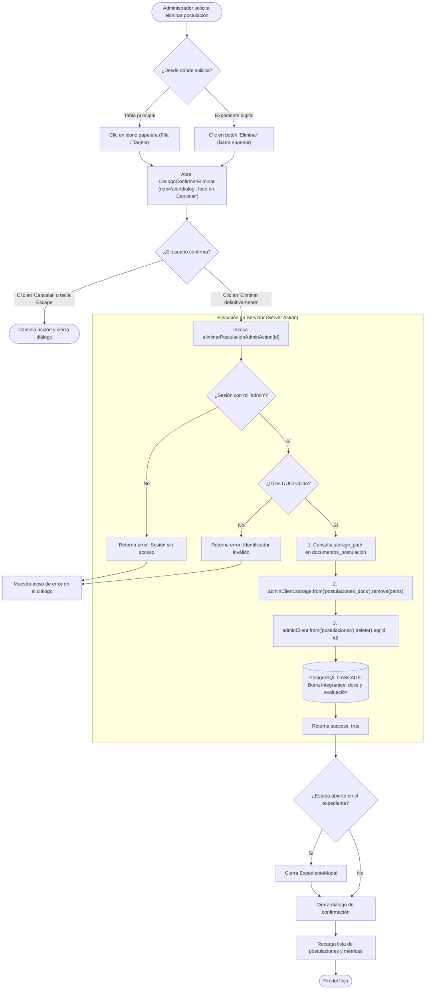

# Manual Operativo de Administración y Evaluación
## Bootcamp de Semilleros de Investigación Cauca INNOVA 2026

**Entidades Convocantes:** Gobernación del Cauca (Secretaría de Desarrollo Económico y Competitividad) en alianza académica con la Corporación Universitaria Autónoma del Cauca (Uniautónoma).  
**Fecha Oficial del Evento:** 14 de noviembre de 2026 (Jornada presencial intensiva de co-creación y prototipado).  
**Cupos Convocatoria:** 7 equipos de semilleros seleccionados (máximo 21 participantes en total, hasta 3 por equipo).  
**Módulo Web:** Panel Administrativo y de Evaluación Técnica (`/admin`).

---

## 1. Introducción y Alcance

Este manual tiene como propósito orientar a los miembros del **Comité Técnico y Evaluadores Oficiales** en el uso integral de la plataforma de evaluación y gestión de postulaciones del **Bootcamp Cauca INNOVA 2026**. 

El sistema proporciona una interfaz centralizada, segura y reactiva que permite:
1. Monitorear el progreso de la convocatoria en tiempo real mediante indicadores clave de rendimiento (KPIs).
2. Filtrar, buscar y priorizar las postulaciones según su nivel formativo y estado de revisión.
3. Consultar el **Expediente Digital** de cada equipo postulante, examinando sus integrantes, justificación de intereses y documentos de soporte adjuntos.
4. Generar **enlaces temporales firmados (Signed URLs)** para la previsualización confidencial y segura de documentos alojados en almacenamiento privado.
5. Aplicar la **Rúbrica de Calificación Oficial** establecida en los Términos de Referencia (TDR), registrando observaciones técnicas y determinando los equipos seleccionados.
6. Exportar la totalidad de la información a un archivo estructurado en **Microsoft Excel (.xlsx)** con tres hojas especializadas.
7. Ejecutar la **eliminación permanente y segura** de postulaciones descartadas, duplicadas o de prueba, garantizando la eliminación física de archivos en Supabase Storage y la eliminación relacional en cascada en la base de datos.

---

## 2. Acceso Seguro al Panel Administrativo

El acceso al panel se encuentra restringido exclusivamente a evaluadores autorizados de la Gobernación del Cauca y Uniautónoma mediante el protocolo de autenticación de Supabase con verificación de atributos en el token de seguridad.

### 2.1 Ruta de Ingreso
Para acceder a la plataforma, navegue en un navegador web compatible (Google Chrome, Firefox, Safari o Microsoft Edge en sus versiones recientes) a la URL:
```text
https://[dominio-oficial]/admin
```
*(En entornos de desarrollo local: `http://localhost:3000/admin` o `http://127.0.0.1:3000/admin`)*.

### 2.2 Proceso de Autenticación
1. Al acceder a la ruta `/admin`, el sistema comprobará si existe una sesión activa. Si no la hay, se desplegará el módulo de inicio de sesión institucional (`AuthAdmin`).
2. Ingrese su **Correo Electrónico Institucional** (ejemplo: `evaluador@caucainnova.gov.co` o cuenta institucional asignada).
3. Ingrese su **Contraseña confidencial**.
4. Haga clic en el botón **"Ingresar al Sistema ↗"**.
5. El sistema validará sus credenciales contra Supabase Auth y comprobará que su usuario posea el rol administrativo (`app_metadata.role = 'admin'`).
6. Si la validación es exitosa, se desplegará inmediatamente el panel con las postulaciones y métricas en tiempo real.

> [!IMPORTANT]
> El sistema no permite el ingreso a usuarios públicos o postulantes. Toda cuenta con acceso al panel debe haber sido aprovisionada previamente en el servicio de identidad de Supabase con el atributo `role: "admin"` en sus metadatos de aplicación (`app_metadata`).

### 2.3 Cierre Seguro de Sesión
Para terminar su jornada de trabajo y garantizar que no queden sesiones abiertas en terminales compartidas, haga clic en el botón **"Cerrar Sesión ✕"** ubicado en el extremo superior derecho de la barra de navegación del panel.

---

## 3. Tablero de Control y Métricas del Bootcamp

En la parte superior del panel se despliega el componente de **Métricas Consolidadas** (`MetricasDashboard`), el cual resume el estado del proceso de selección:

```
┌─────────────────────────┬─────────────────────────┬─────────────────────────┬─────────────────────────┐
│   TOTAL POSTULACIONES   │  PENDIENTES DE REVISIÓN │     HABILITADOS TDR     │     CUPOS OFICIALES     │
│           XX            │           XX            │           XX            │          X / 7          │
│ Colegios: X | Univ: X   │ Requieren validación    │   Cumplen requisitos    │   [████████░░░░] %      │
└─────────────────────────┴─────────────────────────┴─────────────────────────┴─────────────────────────┘
```

### 3.1 Interpretación de Indicadores:
* **Total Postulaciones:** Muestra la cantidad acumulada de equipos que han completado su registro en el formulario público. Incluye un desglose entre:
  * **Colegios (Básica y Media):** Instituciones educativas de bachillerato del Cauca.
  * **Educación Superior:** Universidades, instituciones tecnológicas o técnicas del departamento.
* **Pendientes de Revisión:** Postulaciones en estado `pendiente` que aún no han sido dictaminadas por el comité evaluador o que requieren validación de su aval institucional.
* **Habilitados TDR:** Postulaciones que cumplen con la totalidad de los requisitos de participación y documentación exigida en los TDR.
* **Cupos Oficiales (7 Equipos TDR 2026):** Indicador visual con barra de progreso que refleja el número de equipos en estado `seleccionado` frente al límite estricto de **7 cupos** (máximo 21 estudiantes en total) estipulados para el Bootcamp del **14 de noviembre de 2026**.

---

## 4. Gestión, Búsqueda y Filtrado de Postulaciones

La tabla principal (`TablaPostulaciones`) permite administrar grandes volúmenes de postulaciones de forma fluida y reactiva:

### 4.1 Buscador en Vivo
En la caja de texto con icono de lupa (🔍), ingrese cualquier término de búsqueda:
* Código de radicado oficial (ejemplo: `INNOVA-2026-0001`).
* Nombre del semillero de investigación (ejemplo: *Robótica del Macizo*).
* Nombre de la institución educativa o universidad (ejemplo: *Colegio Mayor del Cauca*).
* Nombre o apellido del docente tutor.

La tabla se actualiza de manera instantánea sin recargar la página.

### 4.2 Filtros por Estado
El menú desplegable **"Todos los Estados"** permite segmentar el listado según las etapas del flujo:
* `Pendientes`: Equipos recién radicados en espera de calificación.
* `Habilitados`: Equipos aprobados en fase documental que pueden ser ponderados.
* `No Habilitados`: Equipos que no presentaron aval o incumplieron requisitos de elegibilidad.
* `Seleccionados (7 cupos)`: Los 7 semilleros elegidos formalmente para asistir al Bootcamp el 14 de noviembre.

### 4.3 Filtro por Nivel Formativo
Permite filtrar entre:
* `Básica y Media (Colegios)`: Garantiza la identificación de propuestas escolares.
* `Educación Superior`: Universidades y tecnológicos.

### 4.4 Alerta de Menores de Edad (⚠️)
En la columna **"Menores"**, el sistema destaca con un distintivo amarillo `⚠️ X menores` a los equipos que incluyen estudiantes menores de 18 años, recordando al evaluador la exigencia obligatoria de revisar el formato de autorización firmado por sus acudientes legales.

### 4.5 Acciones Rápidas en Fila
Al final de cada fila en la vista de escritorio y en cada tarjeta en dispositivos móviles, se disponen dos controles:
1. **Ver Expediente:** Permite abrir el expediente completo del equipo.
2. **Eliminar Postulación (Icono de papelera):** Dispara el protocolo de confirmación para eliminación definitiva (detallado en la Sección 8).

---

## 5. Apertura del Expediente Digital y Visualización Segura

Para ingresar a la información pormenorizada de una postulación, haga clic sobre la fila del equipo correspondiente o use el botón de navegación. Se abrirá la ventana modal interactiva (`ExpedienteModal`).

El expediente se organiza en secciones claras:

### 5.1 Barra Superior y Navegación Entre Expedientes
* **Identificación del equipo:** Nombre del semillero, radicado oficial e institución educativa.
* **Insignia de Estado:** Distintivo visual del estado actual de la postulación.
* **Botón de Eliminación Rápida:** Botón con icono de papelera y texto "Eliminar" para descartar el expediente sin salir de la vista detallada.
* **Paginación entre postulaciones:** Controles para avanzar a la siguiente postulación o retroceder a la anterior (también accionables mediante las flechas del teclado `←` y `→`).
* **Botón Volver / Cerrar:** Cierra el expediente y regresa al listado general (accionable con la tecla `Escape`).

### 5.2 Estudiantes Integrantes (Equipo de 3)
* Ficha individual de cada uno de los 3 estudiantes requeridos por TDR.
* Nombres completos, tipo y número de documento de identidad.
* Correo electrónico y teléfono de contacto.
* Indicador de edad: `Menor de edad` o `Mayor de edad`.

### 5.3 Texto de Motivación e Intereses
* Visualización íntegra de la argumentación redactada por el equipo (mínimo 50 y máximo 2,500 caracteres).
* Conteo de caracteres registrados.

### 5.4 Previsualización Segura de Documentos (Signed URLs)
Los archivos adjuntos de las postulaciones (documentos de identidad, cartas de aval y autorizaciones de menores) son **estrictamente confidenciales** y se encuentran almacenados en un bucket privado de Supabase Storage (`postulaciones_docs`).

Para visualizarlos:
1. Ubique el documento deseado en la lista:
   * **Aval Institucional del Semillero** (`aval_semillero`).
   * **Documento de Identidad - Integrante 1** (`doc_identidad_1`).
   * **Documento de Identidad - Integrante 2** (`doc_identidad_2`).
   * **Documento de Identidad - Integrante 3** (`doc_identidad_3`).
   * **Autorización de Padres / Acudientes** (`autorizacion_menores`, obligatorio si hay menores).
2. Haga clic en el botón **"Ver Documento Seguro ↗"**.
3. El servidor ejecutará la acción `generarUrlDocumentoAction(storagePath)`, la cual solicita a Supabase Storage una **Signed URL (URL firmada criptográficamente)** con una vigencia de **300 segundos (5 minutos)**.
4. El archivo se abrirá en una pestaña nueva del navegador sin exponer la llave maestra ni hacer público el archivo. Pasados los 5 minutos, el enlace caduca de manera automática para salvaguardar la privacidad.

---

## 6. Guía de Evaluación y Calificación Oficial según TDR

Dentro del expediente digital, en el bloque **"Evaluación Oficial según TDR"**, el evaluador dispone de las herramientas de ponderación cuantitativa y cualitativa.

### 6.1 Verificación de Requisitos Habilitantes
Active o desactive la casilla:
* **[✓] Requisitos Habilitantes Cumplidos**:  
  Certifica que el equipo postuló a tres estudiantes regulares de una institución del Cauca, adjuntó la carta de aval firmada por el tutor/rector, anexó los tres documentos de identidad válidos y la autorización de menores de edad (si aplica).  
  *Si un equipo no cumple este requisito habilitante, debe ser calificado con estado `no_habilitado`.*

### 6.2 Criterios de Ponderación (0 a 100 Puntos)
Según lo establecido en el numeral de selección de los Términos de Referencia oficiales de Cauca INNOVA, se deben asignar puntajes en los siguientes cuatro criterios mediante los controles deslizantes (sliders) interactivos:

| Criterio TDR | Peso Oficial | Rango de Puntos | Pautas de Calificación para el Evaluador |
| :--- | :---: | :---: | :--- |
| **1. Motivación e Intereses** | **30%** | **0 a 30 pts** | Evalúa la claridad, entusiasmo, justificación del semillero e interés demostrado hacia la investigación, creatividad y experimentación en el territorio. |
| **2. Pertinencia de la Propuesta** | **30%** | **0 a 30 pts** | Evalúa la coherencia de las áreas de interés del semillero frente a los retos sociales, productivos y sostenibles del departamento del Cauca. |
| **3. Diversidad de Habilidades** | **20%** | **0 a 20 pts** | Evalúa la complementariedad de perfiles, interdisciplinariedad del equipo, distribución de roles y equidad de género o inclusión. |
| **4. Representación Territorial** | **20%** | **0 a 20 pts** | Evalúa el origen geográfico del equipo (municipios PDET, subregiones del Cauca: Norte, Macizo, Centro, Sur, Pacífico) y el equilibrio entre colegios y universidades. |
| **TOTAL MÁXIMO** | **100%** | **0 a 100 pts** | **Suma aritmética calculada en vivo por el sistema.** |

### 6.3 Observaciones Técnicas del Comité
En el campo de texto multilínea, consigne los conceptos, recomendaciones, méritos destacados o causales de inadmisión. Estas observaciones quedarán asociadas permanentemente al historial del semillero.

### 6.4 Asignación de Estado y Guardado
Seleccione el dictamen formal en el menú **"Asignar Estado de Postulación"**:
1. `Pendiente de revisión`: Aún en estudio.
2. `Habilitado (Cumple TDR)`: Aprobó requisitos y cuenta con puntaje asignado.
3. `No Habilitado`: Rechazado por inconsistencia documental o incumplimiento de TDR.
4. `Seleccionado (Cupo oficial 1 de los 7)`: Asignado oficialmente como uno de los 7 equipos que asistirán a la jornada presencial del **14 de noviembre de 2026**.

Por último, haga clic en **"Guardar Calificación y Estado ✓"**. El sistema actualizará la base de datos de inmediato y refrescará el tablero de métricas.

---

## 7. Procedimiento de Exportación a Microsoft Excel (.xlsx)

Para efectos de auditoría pública, presentación de informes ante la Gobernación del Cauca o consolidación de listas de asistencia para la jornada del 14 de noviembre, el panel cuenta con un generador de reportes en Excel basado en la librería de alto rendimiento `ExcelJS`.

### 7.1 Pasos para Exportar
1. En la cabecera de la tabla de postulaciones, ubique el botón con el icono de descarga y texto:  
   **`[ Exportar Excel (.xlsx) ]`**.
2. Haga clic sobre el botón. El sistema procesará el consolidado de datos en el servidor y convertirá las tres estructuras relacionales en un libro de Excel nativo.
3. El archivo se descargará automáticamente en su equipo con una nomenclatura normalizada:
   ```text
   Cauca_INNOVA_Postulaciones_AAAA-MM-DD.xlsx
   ```
   *(Ejemplo: `Cauca_INNOVA_Postulaciones_2026-10-28.xlsx`)*.

### 7.2 Estructura del Libro Excel (3 Hojas Especializadas)

El archivo generado contiene formato visual corporativo (encabezados en azul marino institucional `#10384f`, texto en blanco, bordes finos y alineaciones normalizadas):

#### Hoja 1: "Equipos y Semilleros"
Contiene un registro por cada postulación radicada con las siguientes 10 columnas:
* `Radicado Oficial`: Código correlativo único `INNOVA-2026-XXXX`.
* `Estado`: Estado actual en mayúsculas (`PENDIENTE`, `HABILITADO`, `NO_HABILITADO`, `SELECCIONADO`).
* `Nivel Formativo`: *Básica y Media (Colegio)* o *Educación Superior*.
* `Institución Educativa`: Nombre de la institución o universidad de procedencia.
* `Semillero de Investigación`: Nombre oficial del grupo o semillero.
* `Docente Tutor / Asesor`: Nombre completo del docente responsable.
* `Correo Tutor`: Dirección de correo electrónico del tutor.
* `Teléfono Tutor`: Línea de contacto telefónica.
* `Puntaje Total`: Suma obtenida en la rúbrica oficial (o "Sin evaluar").
* `Fecha Inscripción`: Fecha de radicación formateada localmente (`DD/MM/AAAA`).

#### Hoja 2: "Base de Integrantes"
Contiene el detalle plano de los estudiantes (3 filas por postulación) con 9 columnas:
* `Radicado`: Código de enlace con el equipo.
* `Semillero`: Nombre del semillero de pertenencia.
* `Orden`: Posición del estudiante dentro del equipo (1, 2 o 3).
* `Nombres y Apellidos`: Nombre completo del estudiante.
* `Tipo Doc.`: Tipo de identificación (CC, TI, CE, Pasaporte).
* `Número Documento`: Número de identificación.
* `Correo Electrónico`: Contacto del estudiante.
* `Teléfono`: Línea celular de contacto.
* `¿Es Menor de Edad?`: `SÍ (Menor de edad)` o `NO (Mayor de edad)`.

#### Hoja 3: "Matriz de Evaluación"
Contiene el informe de dictamen técnico del comité evaluador con 10 columnas:
* `Radicado`: Identificador del equipo.
* `Semillero`: Nombre del semillero evaluado.
* `Habilitante`: Dictamen de elegibilidad (*Habilitado*, *No Habilitado*, *Pendiente*).
* `Motivación (/30)`: Puntaje asignado al criterio de motivación.
* `Pertinencia (/30)`: Puntaje asignado a pertinencia frente a retos.
* `Diversidad (/20)`: Puntaje asignado a diversidad e inclusión.
* `Representación (/20)`: Puntaje asignado a representación institucional y territorial.
* `Puntaje Total (/100)`: Suma ponderada consolidada.
* `Observaciones del Comité`: Justificación técnica y retroalimentación emitida.
* `Fecha Evaluación`: Fecha y hora del registro del dictamen.

---

## 8. Protocolo de Eliminación Permanente y Depuración de Recursos

El sistema incorpora un mecanismo de **eliminación definitiva** diseñado para depurar postulaciones erróneas, duplicadas o de prueba durante las fases previas al cierre de la convocatoria.

> [!CAUTION]
> **Acción Irreversible:** La eliminación definitiva suprime permanentemente el registro de la base de datos y borra de forma irrevocable todos los archivos físicos adjuntos (PDFs e imágenes) en Supabase Storage. **No existe papelera de reciclaje ni recuperación posterior**.

### 8.1 Procedimiento Paso a Paso para el Administrador

El administrador dispone de dos puntos de acceso ergonómicos para iniciar el proceso:

#### Opción A: Eliminación Directa desde la Tabla Maestra
1. En la tabla de postulaciones, ubique la fila del semillero que desea eliminar.
2. En la última columna a la derecha de la fila (o junto a la tarjeta en pantallas móviles), haga clic en el botón con el **icono de papelera** (`IconoPapelera`).
3. El evento detiene la propagación del clic para evitar abrir accidentalmente el expediente y despliega de inmediato el diálogo de confirmación `DialogoConfirmarEliminar`.

#### Opción B: Eliminación desde el Expediente Digital
1. Si se encuentra revisando los detalles de una postulación dentro del modal `ExpedienteModal`, diríjase a la barra superior (`BarraExpediente`).
2. Junto a la insignia de estado, haga clic en el botón **"Eliminar"** (icono de papelera).
3. Se superpondrá el diálogo de confirmación `DialogoConfirmarEliminar` manteniendo el contexto del equipo actual.

---

### 8.2 Interacción con el Diálogo Modal de Confirmación (`DialogoConfirmarEliminar`)

El diálogo de confirmación fue construido siguiendo los más estrictos estándares de accesibilidad y prevención de errores humanos:

1. **Resumen de Seguridad:**  
   El cuadro de diálogo presenta de forma explícita los datos de la postulación que va a ser destruida:
   - Nombre del semillero de investigación en negrita.
   - Código de radicado oficial (`INNOVA-2026-XXXX`).
   - Institución educativa de procedencia.
   - Nombre del docente tutor responsable.
   - Conteo de estudiantes integrantes asociados.
   - Conteo de archivos de soporte que serán borrados del Storage.
2. **Foco Inicial Seguro:**  
   Al abrirse el diálogo, **el foco del cursor se posiciona deliberadamente en el botón "Cancelar"**, impidiendo que un usuario que presione rápidamente la tecla `Enter` o la barra espaciadora elimine el registro por error.
3. **Trampa de Foco y Navegación:**  
   La navegación con la tecla `Tab` o `Shift + Tab` queda confinada dentro del diálogo modal.
4. **Cancelación Inmediata:**  
   Puede desistir de la eliminación en cualquier momento haciendo clic en el botón **"Cancelar"**, presionando la tecla **`Escape`** o haciendo clic en el fondo oscuro semi-transparente.
5. **Confirmación Definitiva:**  
   Para proceder, haga clic en el botón de peligro rojo **"Eliminar definitivamente"**.
   - Mientras se ejecuta la operación, ambos botones se deshabilitan (`disabled`).
   - El botón de confirmación cambia su texto a **"Eliminando…"**.
   - Se bloquea el cierre por `Escape` o clic de fondo hasta completar la transacción en el servidor.
6. **Finalización y Limpieza de UI:**  
   - Si la eliminación es exitosa, el diálogo se cierra.
   - Si el expediente modal estaba abierto para esta postulación, se cierra automáticamente (`expediente.cerrar()`).
   - La tabla principal recarga los datos frescos de la base de datos (`alRecargar()`), actualizando el contador de cupos y las métricas consolidadas al instante.

---

### 8.3 Diagrama de Flujo de Eliminación Permanente



---

### 8.4 Aspectos de Accesibilidad (WAI-ARIA)

El diálogo `DialogoConfirmarEliminar` cumple con las pautas WCAG 2.2 AA y WAI-ARIA para diálogos modales de alerta:
* **Rol Semántico:** Utiliza `role="alertdialog"` y `aria-modal="true"`.
* **Identificación Accesible:** `aria-labelledby="titulo-dialogo-eliminar"` y `aria-describedby="desc-dialogo-eliminar"`.
* **Restauración de Foco:** Al desmontarse el diálogo, el foco vuelve automáticamente al elemento de la interfaz que lo originó.
* **Bloqueo de Desplazamiento:** Impide el scroll de fondo (`overflow: hidden` en el `body`) mientras el diálogo se encuentra visible.
* **Movimiento Reducido:** Respeta la configuración de accesibilidad del sistema operativo (`prefers-reduced-motion`) desactivando transiciones y animaciones de escala.

---

## 9. Resolución de Incidencias Frecuentes

* **"Tu sesión no tiene acceso a este panel. Inicia sesión de nuevo"**:
  * Causa: La cookie de sesión JWT expiró o el usuario carece del rol `admin` en `app_metadata`.
  * Solución: Cierre sesión y vuelva a ingresar con su cuenta institucional autorizada.
* **"No pudimos eliminar la postulación. Inténtalo de nuevo en unos minutos"**:
  * Causa: Error transitorio de red o bloqueo temporal en la base de datos de Supabase.
  * Solución: Espere unos instantes y reintente la operación. Si la postulación ya no aparece en el listado tras refrescar (`alRecargar`), la eliminación se completó satisfactoriamente.
* **"Error al generar enlace seguro de documento"**:
  * Causa: La ruta de almacenamiento fue modificada o el archivo fue purgado previamente.
  * Solución: Verifique si el expediente cuenta con documentos válidos o reintente la generación del enlace temporal.
* **El botón de Exportar a Excel no descarga el archivo**:
  * Causa: Bloqueador de ventanas emergentes o descargas automáticas en el navegador.
  * Solución: Autorice las descargas desde el dominio del bootcamp en la barra de direcciones de su navegador web.
